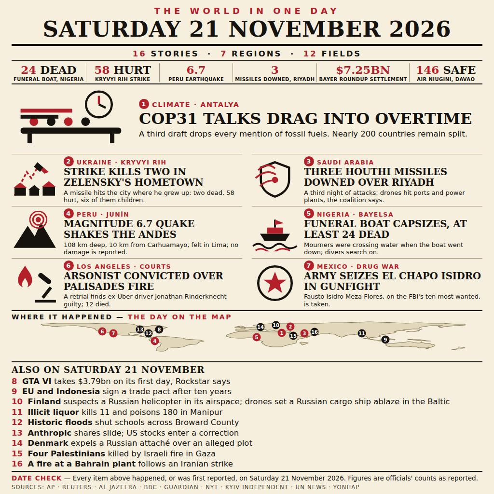

[](https://make.fun/bounty/news-image-20261121?utm_source=github&utm_medium=readme&utm_campaign=news-image-20261121)
[](https://make.fun/bounty/news-image-20261121/leaderboard?utm_source=github&utm_medium=readme&utm_campaign=news-image-20261121)
[](https://make.fun/bounty/news-image-20261121?utm_source=github&utm_medium=readme&utm_campaign=news-image-20261121)

# The World in One Day — 21 November 2026

An entry for make.fun's bounty **“Sum up 21 November's world news in one image”**, run under the
`program/v1` harness. The deliverable is a single 1024×1024 PNG: one printed front page that
carries the news of Saturday 21 November 2026, dated in giant type on its face, and built to
stay readable when the page is scaled down to about 300 pixels across.



## The program

`main.ts` is Node 22, standard library only, and does one thing: it copies `entry.png` from the
repository root to `$MAKEFUN_OUTPUT_DIR/entry.png` (default `/output`), byte for byte, with no
decode and no re-encode. Two runs write identical bytes.

```sh
mkdir -p out && MAKEFUN_OUTPUT_DIR=out node main.ts
cmp entry.png out/entry.png && echo identical
```

The image is shipped in the repository rather than drawn at run time: the harness sandbox has
no network, and the rules say plainly that the simplest entry is a repository holding the image
and a one-line program that copies it there.

## What the page says

Sixteen stories, in three reading levels, so the page survives being shrunk:

1. **A stat strip** — the day in six numbers: 24 dead in the Bayelsa funeral-boat capsizing,
   58 hurt in the Kryvyi Rih strike, a magnitude 6.7 quake in Peru, 3 missiles downed over
   Riyadh, Bayer's $7.25bn Roundup settlement, 146 safe off the Air Niugini flight at Davao.
2. **Seven pictured leads**, each with one bold drawn illustration, a region tag, one headline
   and one short caption — the COP31 talks in Antalya dragging into overtime as the lead, then
   Kryvyi Rih, Riyadh, the Peru quake, the Bayelsa boat, the Palisades-fire arson verdict in
   Los Angeles, and the army's capture of El Chapo Isidro in Mexico.
3. **A world locator map** — numbered dots place all sixteen stories, the page's focal point —
   and an **“Also on Saturday 21 November”** rail of nine one-line briefs: GTA VI's first-day
   $3.79bn, the EU–Indonesia trade pact, Finland's airspace suspicion and the burning Russian
   cargo ship in the Baltic, Manipur's illicit-liquor deaths, Broward County's floods,
   Anthropic's slide and the US stock correction, Denmark's expulsion of a Russian attaché,
   four Palestinians killed in Gaza, and the Bahrain plant fire after an Iranian strike.

A date-check line closes the page: every item happened, or was first reported, on Saturday
21 November 2026, with figures as officials reported them. Sources: AP, Reuters, Al Jazeera,
BBC, Guardian, NYT, Kyiv Independent, UN News, Yonhap.
